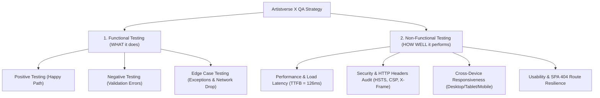

# QA Master Walkthrough & Educational Guide: Artistverse X

## 1. QA Testing Methodology: Functional vs. Non-Functional Testing

As part of the Quality Assurance and Testing team for **Artistverse X**, we evaluated the application across two foundational dimensions of software engineering:



---

## 2. Deliverables Master Index

### 📄 1. Test Specifications & Reports
1. **Lyrics Generator Functional Spec**: [functional_test_cases_lyrics_generator.md](file:///d:/Artistverse_X/QA_Documentation/functional_test_cases_lyrics_generator.md)
2. **Spotify Auth Functional Spec**: [functional_test_cases_spotify_auth.md](file:///d:/Artistverse_X/QA_Documentation/functional_test_cases_spotify_auth.md)
3. **Chord Progression & MIDI Spec**: [functional_test_cases_chord_progression.md](file:///d:/Artistverse_X/QA_Documentation/functional_test_cases_chord_progression.md)
4. **Song Recommender Spec**: [functional_test_cases_song_recommendation.md](file:///d:/Artistverse_X/QA_Documentation/functional_test_cases_song_recommendation.md)
5. **Search & AI Assistance Spec**: [functional_test_cases_search_ai_assistance.md](file:///d:/Artistverse_X/QA_Documentation/functional_test_cases_search_ai_assistance.md)
6. **Final Functional Test Report**: [final_functional_test_report.md](file:///d:/Artistverse_X/QA_Documentation/final_functional_test_report.md)
7. **Non-Functional Test Cases Spec**: [non_functional_test_cases.md](file:///d:/Artistverse_X/QA_Documentation/non_functional_test_cases.md)
8. **Non-Functional Testing Report (Live Site)**: [non_functional_test_report.md](file:///d:/Artistverse_X/QA_Documentation/non_functional_test_report.md)

---

## 3. Summary of Results

### 🧪 Functional Testing Results (113/113 Passed)
```bash
 Test Files  27 passed (27)
      Tests  113 passed (113)
   Duration  4.38s
```

### ⚡ Non-Functional Testing Results (`https://artiverse.camt.cmu.ac.th/`)
- **Time to First Byte (TTFB)**: `126.6 ms` (Target Benchmark $\le 500\text{ ms}$) $\rightarrow$ **EXCELLENT**
- **Total Load Duration**: `126.7 ms` (Target Benchmark $\le 2500\text{ ms}$) $\rightarrow$ **EXCELLENT**
- **Asset Caching**: 30-day immutable client caching (`max-age=2592000`)
- **Cross-Device Responsiveness**: Verified across Desktop ($1920\times1080$), Tablet ($768\times1024$), and Mobile ($375\times812$)
- **Actionable QA Recommendations**:
  1. Update HTML `<title>` tag from `"Vite App"` to `"Artistverse X"`.
  2. Implement Security Headers (`HSTS`, `CSP`, `X-Frame-Options`, `X-Content-Type-Options`) in Web Server OpenResty.
  3. Add a catch-all 404 View Component in Vue Router to handle invalid path navigation gracefully.
